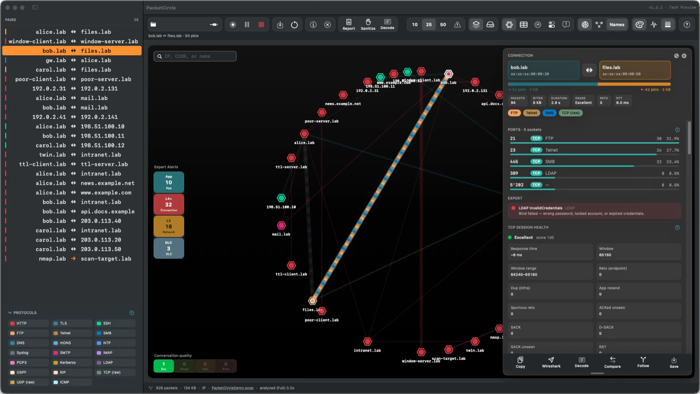

# PacketCircle Native Docs

  

Documentation for **PacketCircle Native** — the circle-first network conversation explorer for **macOS, iOS / iPadOS, Linux and Windows**. It evolved from the open-source [PacketCircle Wireshark plugin](https://github.com/netwho/PacketCircle) and runs without Wireshark.

**PacketCircle is not a mobile Wireshark.** It contains **no open-source Wireshark / libwireshark dissection**. Decodes are native and limited: reasonable IP and TCP detail and some application-layer recognition, not comparable to Wireshark's dissectors. Use PacketCircle to find the conversation that matters, then go deep in Wireshark.

  

**Free to use** · **not GPL / not open source** — see [License](./docs/LICENSE.md).  
We do **not** collect ANY data — see [Privacy](./docs/PRIVACY.md).

## Start here

**[Master document](./docs/PACKETCIRCLE-NATIVE.md)** — motivation, scope, platforms, licensing, privacy, architecture, core concepts and the feature matrix.

## Pick your platform

| Platform | Install | Quickstart | User manual | Limitations |
|---|---|---|---|---|
| **macOS** 14+ | [Install](./docs/macos/INSTALL.md) | [Quickstart](./docs/macos/QUICKSTART.md) | [Manual](./docs/macos/USER-MANUAL.md) · [Detailed usage](./docs/macos/DETAILED-USAGE.md) | [Limitations](./docs/macos/LIMITATIONS.md) |
| **iOS / iPadOS** 17+ | [Install](./docs/ios/INSTALL.md) | [Quickstart](./docs/ios/QUICKSTART.md) | [Manual](./docs/ios/USER-MANUAL.md) · [Detailed usage](./docs/ios/DETAILED-USAGE.md) | [Limitations](./docs/ios/LIMITATIONS.md) |
| **Linux** (Ubuntu 24.04 and other glibc distros) | [Install](./docs/linux/INSTALL.md) | [Quickstart](./docs/linux/QUICKSTART.md) | [Manual](./docs/linux/USER-MANUAL.md) | [Limitations](./docs/linux/LIMITATIONS.md) |
| **Windows** 10 / 11 x64 | [Install](./docs/windows/INSTALL.md) | [Quickstart](./docs/windows/QUICKSTART.md) | [Manual](./docs/windows/USER-MANUAL.md) | [Limitations](./docs/windows/LIMITATIONS.md) |

## Release information

- [Release history](./docs/RELEASES.md) — all versions, current **1.3.2**
- iOS: [1.2.4 release notes](./docs/ios/RELEASE-NOTES-1.2.4.md) · [1.1.0](./docs/ios/RELEASE-NOTES-1.1.0.md) · [1.0.0 known issues (archive)](./docs/ios/KNOWN-ISSUES-1.0.0.md)

## Legal

- [License](./docs/LICENSE.md)
- [Privacy Policy](./docs/PRIVACY.md)

---

*Made with love for the packet community.*
