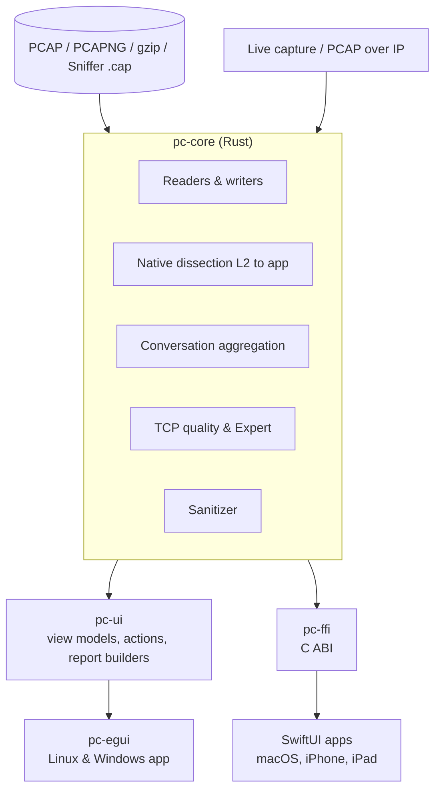

# PacketCircle Native — Master Document

<p align="center">
  
</p>

This is the starting point for everything about **PacketCircle Native**: why it exists, what it is and is not, how it is licensed, and how it is built. Platform-specific installation and usage live in the per-platform guides linked at the end.

**Contents**

1. [Motivation](#1-motivation)
2. [What PacketCircle Native is — and is not](#2-what-packetcircle-native-is--and-is-not)
3. [Platforms and versions](#3-platforms-and-versions)
4. [Licensing](#4-licensing)
5. [Privacy](#5-privacy)
6. [Architecture](#6-architecture)
7. [Core concepts](#7-core-concepts)
8. [Feature overview](#8-feature-overview)
9. [Capture formats and limits](#9-capture-formats-and-limits)
10. [Working with Wireshark](#10-working-with-wireshark)
11. [Documentation map](#11-documentation-map)

---

## 1. Motivation

Packet captures are the ground truth of network troubleshooting, but a capture with a million frames is a poor starting point. Before you can ask *"why is this TCP session slow?"* you need to know **who talked to whom, over what, and how well**.

The original [PacketCircle Wireshark plugin](https://github.com/netwho/PacketCircle) answered that with a **circle**: hosts sit on a ring, every conversation is a chord between two hosts, and colors show the protocol. A glance tells you the shape of the traffic — the chatty server, the host scanning the whole subnet, the one pair that never completes a handshake.

PacketCircle Native takes that idea out of Wireshark and onto every desktop and phone:

- **No Wireshark needed.** Open a capture on a laptop, a phone, or a headless-looking Linux box without installing a protocol analyzer.
- **Triage first.** Circle, services map, gauges, TCP session-quality scores and Expert alerts get you to the right conversation fast. Then you go deep — in PacketCircle's own decode, or by handing the filter to Wireshark.
- **Same engine everywhere.** One analysis core means the same capture gives the same answers on macOS, iOS, Linux and Windows.
- **Private by construction.** Analysis happens on your device. Captures are never uploaded.

## 2. What PacketCircle Native is — and is not

**It is** a conversation-first capture explorer:

- A **circle** of hosts and conversations, a **services** view (hosts left, applications right), and a **topology map** built from STP / CDP / LLDP / routing traffic.
- **TCP session-quality** scoring (0–100) with grade, retransmits, resets, zero windows, RTT and more.
- **Expert alerts** grouped by layer (Application, Transport, Network, Link).
- A native **decode** view and **Follow TCP stream** for orientation.
- **Compare conversations**, **sanitize** (scrub) a capture for sharing, and generate a **PDF report**.
- **Live capture** and **PCAP-over-IP** on desktop platforms.

**It is not** a replacement for Wireshark:

> PacketCircle contains **no open-source Wireshark / libwireshark dissection**. Its decodes are native and deliberately limited: reasonable IP and TCP detail and recognition of common application protocols, but nothing close to Wireshark's thousands of dissectors. Treat PacketCircle as the map and Wireshark as the microscope.

## 3. Platforms and versions

| Platform | Version in this documentation | UI | Engine | Live capture | Guide |
|---|---|---|---|---|---|
| **macOS** 14+ | 1.3.2 (Tech Preview) | SwiftUI | Rust core (Swift engine in older builds) | Yes (admin prompt for BPF) | [macOS](./macos/INSTALL.md) |
| **iOS / iPadOS** 17+ | 1.3.2 (App Store releases may lag) | SwiftUI | Rust core | No — opens files on the device | [iOS](./ios/INSTALL.md) |
| **Linux** (Ubuntu 24.04 reference; other glibc distros) | 1.3.2 (Tech Preview) | egui | Rust core | Yes (libpcap + `setcap`) | [Linux](./linux/INSTALL.md) |
| **Windows** 10 / 11 (x64) | 1.3.2 (Tech Preview) | egui | Rust core | Yes (optional Npcap) | [Windows](./windows/INSTALL.md) |

Feature parity is high but not identical. Mac, Linux and Windows are the full desktop experience; iPhone and iPad are an offline analyzer built for quick looks on the go. Each platform's *Limitations* page lists the differences.

## 4. Licensing

- PacketCircle Native is **free to use**, with no license fee, no in-app purchases, no telemetry, and no limit on features, capture size, or how long you use it.
- It is **proprietary and not open source**. Redistribution of the source or compiled binaries outside the authorized channels requires written permission from the author.
- The [PacketCircle Wireshark plugin](https://github.com/netwho/PacketCircle) is a **separate project under GPL v2**. PacketCircle Native does not ship GPL Wireshark code.
- Optional libwiretap support exists only as an opt-in local developer build and is **not** part of any distributed build.
- iOS and macOS App Store builds are additionally covered by Apple's Licensed Application End User License Agreement.

The legal text is in [LICENSE](./LICENSE.md).

## 5. Privacy

PacketCircle does **not** collect any data. There is no analytics, no crash upload, no account, and no network call from the analysis engine. Captures stay where you opened them. Details, including the iOS-versus-macOS differences relevant to App Store review, are in the [Privacy Policy](./PRIVACY.md).

The only network access is something you start yourself: live capture from an interface you select, or *PCAP over IP* from a source you specify.

## 6. Architecture

One repository, one engine. **All packet logic lives in a Rust core**; front ends only present it.



| Layer | Role |
|---|---|
| **pc-core** | Capture readers/writers, native dissection, conversation aggregation, TCP quality, Expert findings, sanitizer, report data. No UI, no network calls, no `unsafe`. |
| **pc-ui** | Toolkit-neutral view models, actions, and PDF/report builders. |
| **pc-egui** | The Linux and Windows desktop app. Draws `pc-ui` models and never re-implements analysis. |
| **pc-ffi** | The C ABI used by the Swift apps — the only place `unsafe` code is allowed. |
| **SwiftUI apps** | Native macOS and iPhone/iPad screens. |

### Analysis pipeline

```
Frame bytes + link type
  → link decode (Ethernet, VLAN, Linux cooked, 802.11/Radiotap …)
  → network (IPv4, IPv6, ARP)
  → transport (TCP, UDP, ICMP, SCTP …)
  → protocol tag + application recognition
  → conversation aggregate (counts, ports, TCP quality, Expert)
```

Analysis **streams** the file and keeps aggregates only, so memory grows with the number of unique conversations and TCP flows, not with file size. See each platform's *Limitations* page for the practical ceilings.

### Two tiers of detail

| Tier | Where | Used for |
|---|---|---|
| **A — in-app** | PacketCircle's own engine | Circle, search, ports, TCP quality, Expert, limited decode |
| **B — companion** | Wireshark / tshark | Full protocol decode, deep dialogs, advanced graphs |

Opening a file never depends on tier B.

## 7. Core concepts

**Conversation.** A pair of endpoints (IP↔IP or, in MAC mode, MAC↔MAC) with packet and byte counts, protocols seen, ports, and optional TCP quality. In the circle it is a chord.

**Socket.** A specific port pair inside a conversation (for example `10.0.0.5 ↔ 10.0.0.9 TCP 443`). Session details, Expert findings and Follow TCP Stream can be scoped to one socket.

**Circle layouts.** *Hosts* (hosts on a ring), *Services* (hosts on the left, applications on the right, edges colored by protocol) and *Map* (infrastructure topology).

**Quality score (0–100).** A native estimate of TCP session health from retransmissions, resets, zero-window events, handshake and RTT behavior, graded for quick scanning. It is an estimate, not a Wireshark `tcp.analysis` replacement.

**Expert alerts.** Findings grouped into **Application**, **Transport**, **Network** and **Link** bands, with warnings, errors and notes.

**Sanitize.** A streaming scrub — cleartext, all payload, or payload plus IP/MAC rewriting — with checksum fix-ups, writing a shareable PCAPNG.

## 8. Feature overview

| Feature | macOS | iOS | Linux | Windows |
|---|:--:|:--:|:--:|:--:|
| Open PCAP / PCAPNG / gzip / Sniffer `.cap`/`.caz` | ✓ | ✓ | ✓ | ✓ |
| Circle, Services, Map layouts | ✓ | ✓ | ✓ | ✓ |
| Conversation details and TCP session quality | ✓ | ✓ | ✓ | ✓ |
| Gauges and talkers | ✓ | ✓ | ✓ | ✓ |
| Expert alerts | ✓ | ✓ | ✓ | ✓ |
| Decode (native, limited) | ✓ | ✓ | ✓ | ✓ |
| Follow TCP stream | ✓ | ✓ | ✓ | ✓ |
| Display-filter in Decode | ✓ | ✓ | ✓ | ✓ |
| Compare conversations | ✓ | wide screens only (preview) | ✓ | ✓ |
| Sanitize on save / export | ✓ | ✓ | ✓ | ✓ |
| PDF report | ✓ | — | ✓ | ✓ |
| Live capture | ✓ | — | ✓ | ✓ (Npcap) |
| PCAP over IP | ✓ | — | ✓ | ✓ |
| Copy capture / display filter | ✓ | ✓ | ✓ | ✓ |
| Hand off to Wireshark | ✓ | — | ✓ | ✓ |
| Light / dark / system appearance | ✓ | ✓ | ✓ | ✓ |

If a cell here disagrees with the in-app Help for your installed version, the app wins — please open an issue.

## 9. Capture formats and limits

**Read:** classic PCAP (both endiannesses, micro- and nanosecond), PCAPNG (multiple interfaces and link types), gzip-compressed captures, and Sniffer Pro `.cap` / `.caz`. Other formats: convert with `editcap` first.

**Write:** PCAPNG (sanitize, save a copy) and classic PCAP (export a conversation).

There is no hard maximum file size. Practical guidance:

| Platform | Comfortable | Tight |
|---|---|---|
| Desktop (macOS, Linux, Windows) | hundreds of MB to low GB | multi-GB with millions of unique pairs |
| iPhone / iPad | about 50–200 MB | larger files may be terminated by the system |

For very large captures the desktop apps offer a **Light** analysis depth (fewer per-conversation details) instead of **Full**. Feature-specific caps (decode frame count, Follow TCP payload size, Top-N choices) are listed in the platform *Limitations* pages.

## 10. Working with Wireshark

PacketCircle and Wireshark are complementary:

1. Triage in PacketCircle.
2. Select a conversation or socket and **copy its filter** (display filter or BPF capture filter).
3. Open the same capture in Wireshark and paste the filter — or use **Send to Wireshark** on the desktop apps where Wireshark is installed.

PacketCircle never requires Wireshark, and never ships its code.

## 11. Documentation map

| Platform | Install | Quickstart | User manual | Limitations |
|---|---|---|---|---|
| macOS | [INSTALL](./macos/INSTALL.md) | [Quickstart](./macos/QUICKSTART.md) | [Manual](./macos/USER-MANUAL.md) | [Limitations](./macos/LIMITATIONS.md) |
| iOS / iPadOS | [INSTALL](./ios/INSTALL.md) | [Quickstart](./ios/QUICKSTART.md) | [Manual](./ios/USER-MANUAL.md) | [Limitations](./ios/LIMITATIONS.md) |
| Linux | [INSTALL](./linux/INSTALL.md) | [Quickstart](./linux/QUICKSTART.md) | [Manual](./linux/USER-MANUAL.md) | [Limitations](./linux/LIMITATIONS.md) |
| Windows | [INSTALL](./windows/INSTALL.md) | [Quickstart](./windows/QUICKSTART.md) | [Manual](./windows/USER-MANUAL.md) | [Limitations](./windows/LIMITATIONS.md) |

Also: [Release history](./RELEASES.md) · [License](./LICENSE.md) · [Privacy](./PRIVACY.md)

---

*Made with love for the packet community.*
