# PacketCircle for Linux — User Manual

This manual covers PacketCircle 1.3.x on Linux. The Windows app is the same program; see the [Windows manual](../windows/USER-MANUAL.md) for platform differences. For background and licensing see the [master document](../PACKETCIRCLE-NATIVE.md).

> **PacketCircle is not Wireshark.** It has no Wireshark dissectors. Decode is native and limited. Use it to find the conversation that matters, then hand off to Wireshark when you need full protocol detail.

**Contents:** 1 Getting started · 2 Main window · 3 Circle layouts · 4 Connection details · 5 Conversations table · 6 Expert alerts · 7 Gauges · 8 Time slice · 9 Decode · 10 Follow TCP stream · 11 Compare · 12 Live capture and PCAP over IP · 13 Sanitize and save · 14 Reports · 15 Settings · 16 Workflows · 17 Environment variables

---

## 1. Getting started

Open a capture by:

- passing it on the command line: `packetcircle capture.pcapng`
- **Open…** in the toolbar (needs `xdg-desktop-portal` for the file dialog)
- dragging the file onto the window

Supported: PCAP, PCAPNG, gzip-compressed versions, and Sniffer Pro `.cap` / `.caz`.

**Large captures.** For big files the app asks whether to analyze with **Full** or **Light** depth. Light skips some per-conversation detail to stay fast and light on memory. The footer shows which was used (for example `analyzed (Full) 5.5s`).

While a file is being read the bottom bar shows the frame counter and a **Stop** button at the right.

## 2. The main window

| Area | Purpose |
|---|---|
| **Toolbar** | Open, capture, layout, Top-N, metric, IP/MAC mode, search, Info, Help, Close capture |
| **Circle / Table** | The main canvas |
| **Pairs list (sidebar)** | Every conversation, with protocol legend and quality; hover to highlight the chord |
| **Expert tiles** | Counters for Application, Transport, Network, Link and All |
| **Footer** | Packets, bytes, file name, analysis time and depth |

**Search** accepts IPs, CIDR ranges, `TCP 443`, protocol categories and Expert terms (type `expert` followed by a group or message — see **Help**).

**Top N** limits the circle to the 10, 25 or 50 busiest conversations by packets or bytes. Filtering happens first, then Top-N.

**Info** shows capture details (file, size, SHA-256, times, link types); when nothing is open it shows About.

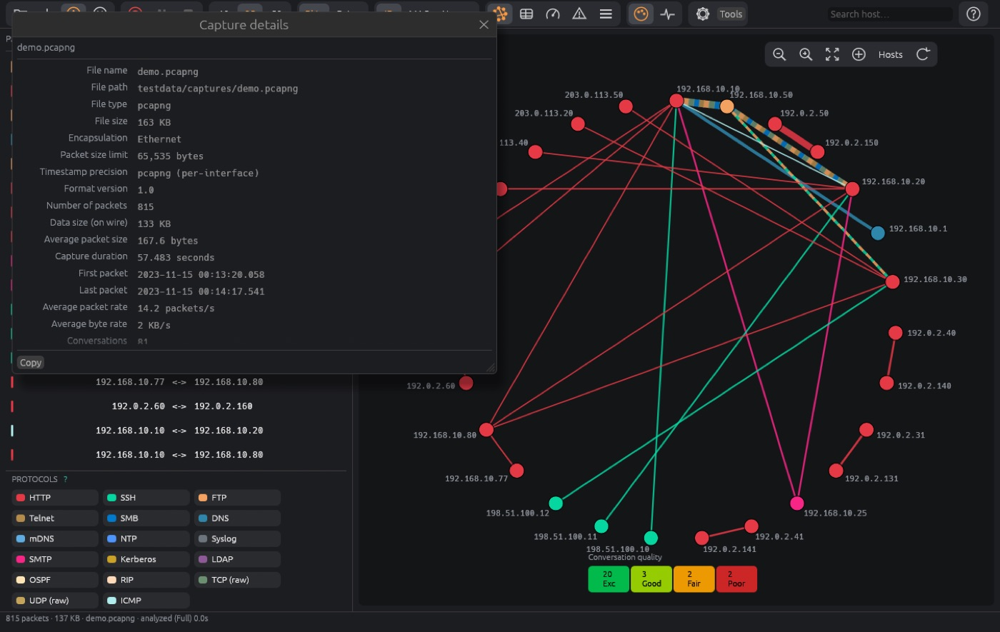

## 3. Circle layouts

- **Hosts** — hosts on a ring, one chord per conversation. One-way conversations draw as a dotted arrow; multi-protocol conversations draw as colored dashes.
- **Services** — hosts on the left, applications on the right, edges colored by protocol.
- **Map** — infrastructure topology built from STP, CDP, LLDP and routing traffic. Click a node to open its details.

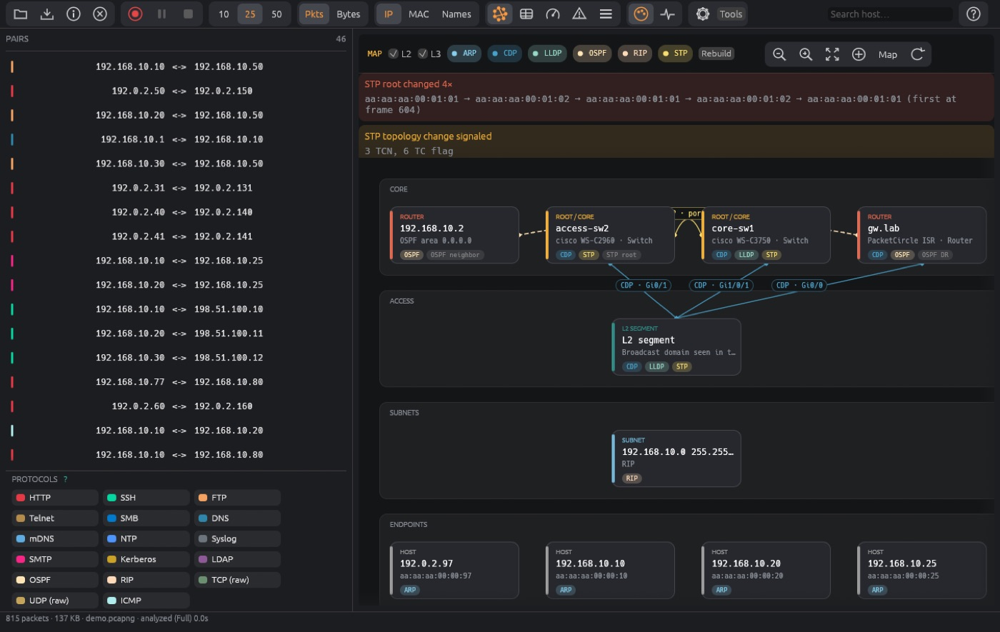

The circle and the map always draw on a black canvas regardless of the appearance setting.

Switch between **IP** and **MAC** mode to analyze L3 or L2 pairs.

## 4. Connection details

Click a chord (or a pairs-list row).

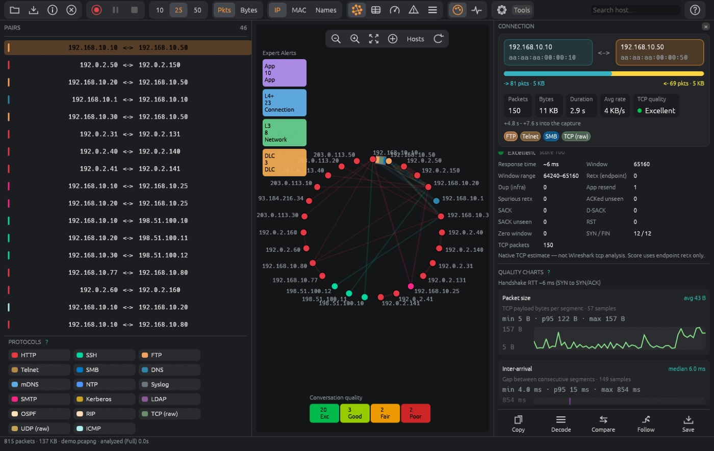

- **Header** — both endpoints (name, address, MAC, port) and stat chips.
- **Sockets** — every port pair in the conversation; select one to scope everything below to that socket. *Other sockets* lists the rest and marks the ones with alerts.
- **TCP quality** — grade, score, RTT, retransmits, resets, zero-window events, MSS, fragmentation.
- **Charts** — sequence, throughput and window over time.
- **Application messages** — drawn as a two-lifeline sequence; identical neighbors collapse to ×N.
- **Expert** — findings for this socket plus host-pair L3 / link findings.

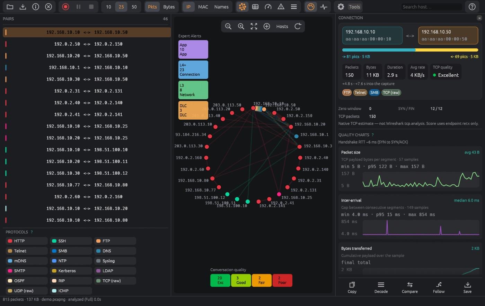
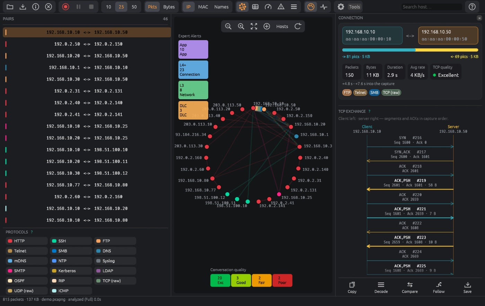

**Actions** (across the top of the pane): **Copy** (Wireshark display filter, BPF capture filter, or the Follow-stream filter), **Wireshark**, **Decode**, **Compare**, **Follow**, **Save**.

**Copy capture filter** produces a BPF expression for the pair, narrowed to `tcp port` or `udp port` when a socket is selected.

## 5. Conversations table

The table shows every conversation sortable by packets, bytes, protocol, quality and Expert findings.

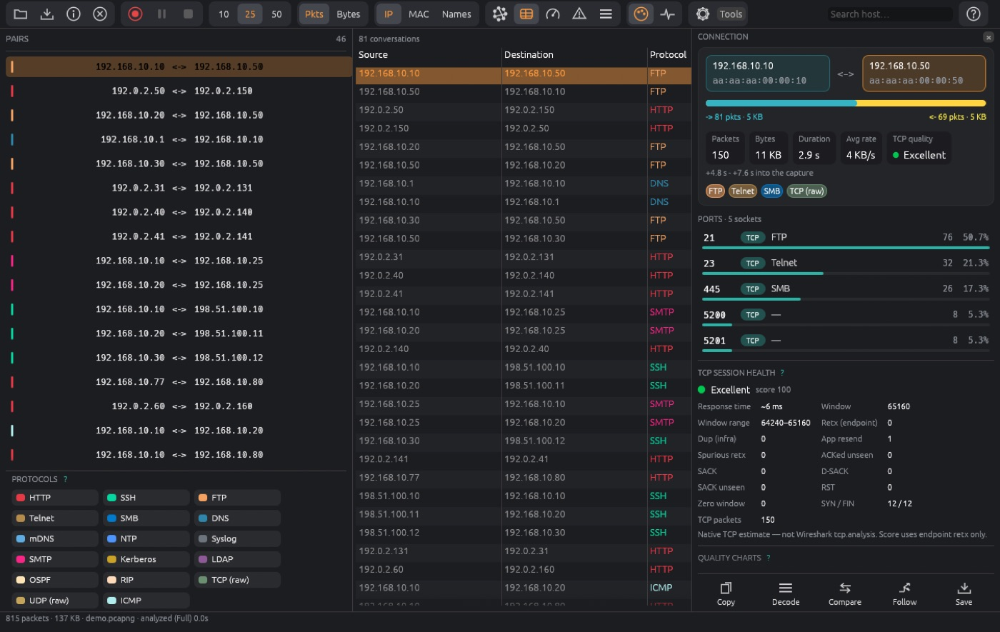

## 6. Expert alerts

Tiles for **Application**, **Transport**, **Network**, **Link** and **All**. Totals include notes (a TTL = 1 finding counts under Network).

| Band | Typical findings |
|---|---|
| **Application** | HTTP 4xx/5xx, TLS alerts, SMTP/POP3/IMAP, FTP, DNS RCODEs, LDAP, Kerberos, SSH |
| **Transport** | TCP quality: retransmissions, resets, zero windows |
| **Network** | ICMP unreachable / time-exceeded, TTL and fragment issues, duplicate IP |
| **Link** | Real frame problems (runts, giants). Short unpadded Ethernet frames are not counted as runts; a PCAP original length left by snaplen or GRO is not a jumbo frame |

Left-click a tile to filter conversations that have findings in that band. **Right-click** a tile for the alert list: select the conversation, hide that finding for this conversation, or suppress the alert type everywhere. **Right-click a quality grade** to list conversations of that grade.

Re-enable suppressed types in **Settings → Expert**.

## 7. Gauges

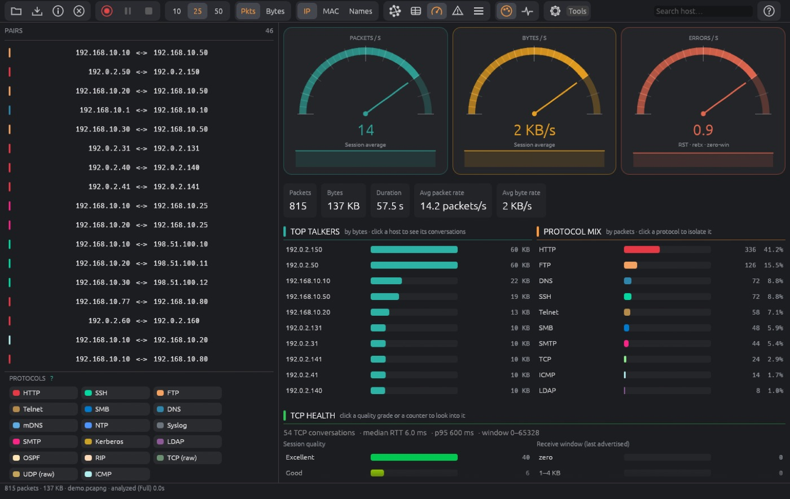

Hosts, Protocols and TCP health are clickable and apply the matching host, protocol, or grade filter to the circle. Problem conversations sit beside the quality timeline.

## 8. Time slice

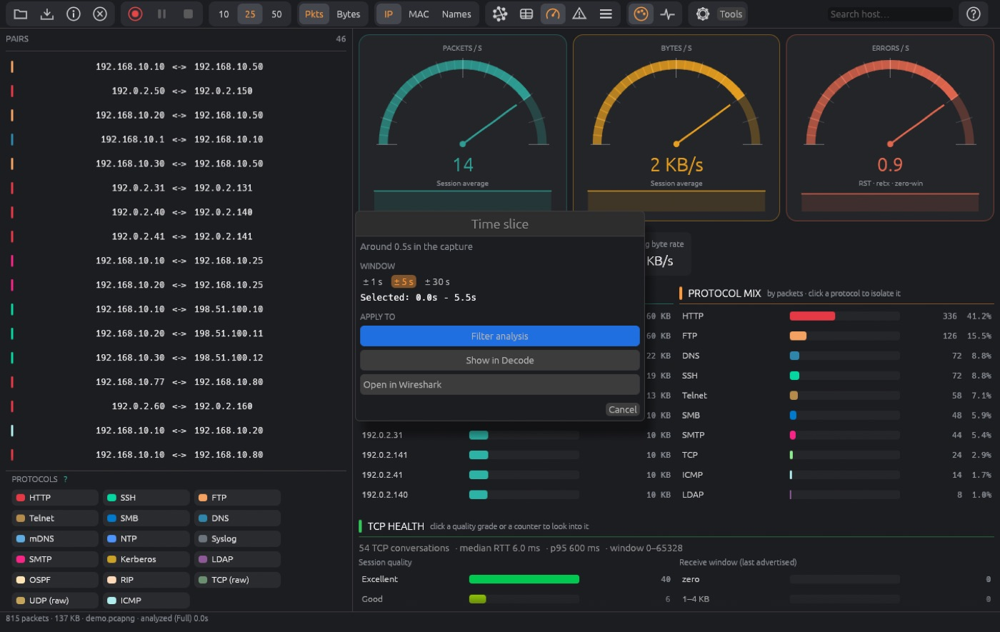

Restrict the analysis to a time window to focus on an incident without re-opening the file.

## 9. Decode

A packet list, a protocol tree and hex pane for the selected conversation. A **display filter** (Wireshark syntax, with autocomplete from PacketCircle's own field catalog) sits beside **search** (text or hex). `tcp.analysis.*` matches PacketCircle's own native per-packet findings, not Wireshark's analysis engine.

Per-frame Expert info appears at the top of the tree. TLS alert records show level and meaning when cleartext; encrypted alerts are labeled as opaque. **Send to Wireshark** opens the capture with the current filter if Wireshark is installed.

Decode stops after the configured maximum number of frames (see [Limitations](./LIMITATIONS.md)).

## 10. Follow TCP stream

Reassembles the selected TCP socket's payload, shown as text or hex per direction. Reassembly is capped at 2 MB per stream.

## 11. Compare conversations

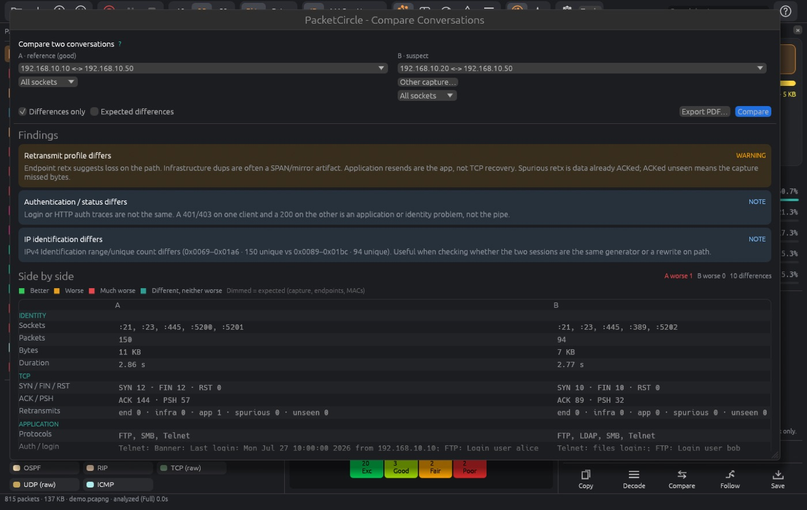

Pick conversation A (the reference) and B (another conversation or a second capture). The table compares timing, grade, score, RST, retransmits, zero window, MSS and fragmentation; the worse value is colored amber to red by the size of the gap and the better value green, with a label such as `worse · Δ 212 ms · ×3.4`. Differences that are expected (capture, endpoints, MACs, IPs, IP ID) are dimmed and hidden unless **Expected differences** is ticked.

## 12. Live capture and PCAP over IP

Enable capture once: `packetcircle-capture enable` (see [Installation](./INSTALL.md#5-allow-live-capture)).

- **Capture…** lists interfaces with live activity, takes a **BPF filter**, and records into a growing file that is analyzed as it grows.
- **PCAP over IP** records a classic-PCAP stream from a remote source; no special permission is needed.
- After **Stop**, the recording is analyzed in full and stays open. **Save a copy…** writes it where you want it.

Long live sessions re-analyze a growing file and get CPU-heavy; stop when you are done.

## 13. Sanitize and save

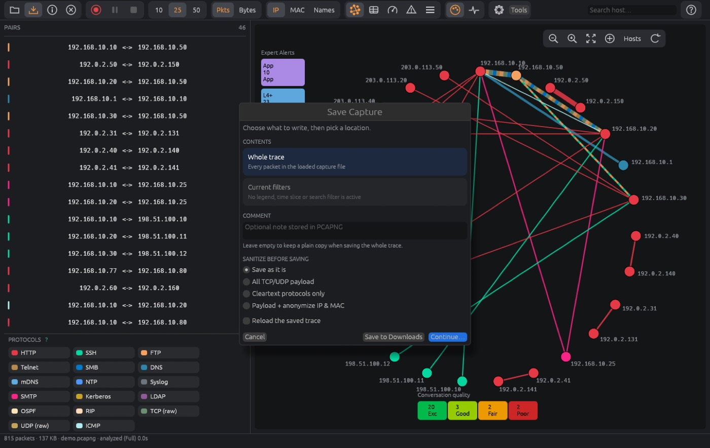
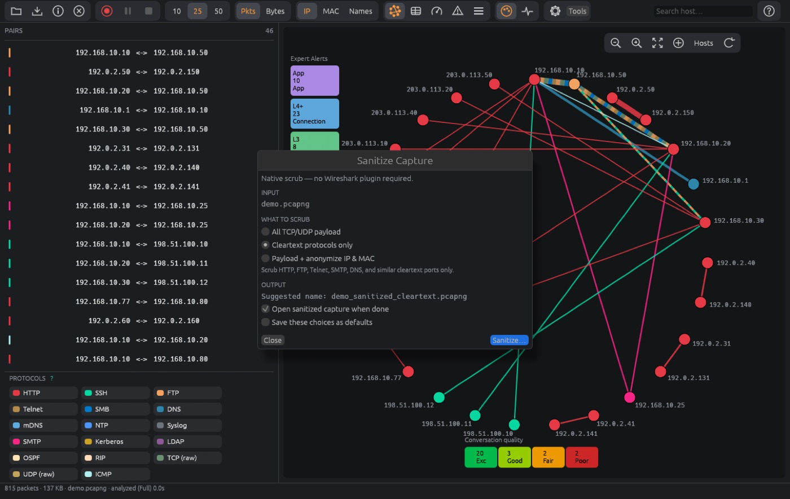

Save, Save session and export ask whether to sanitize first. The choice lasts for the session.

| Mode | Effect |
|---|---|
| Cleartext | Scrubs readable application payload |
| All payload | Removes all payload bytes |
| Payload + IP/MAC | Also rewrites addresses consistently |

Checksums are fixed up; output is PCAPNG. Sanitize runs natively with no Wireshark involved. Review the result before sharing — no scrubber is a guarantee.

## 14. Reports

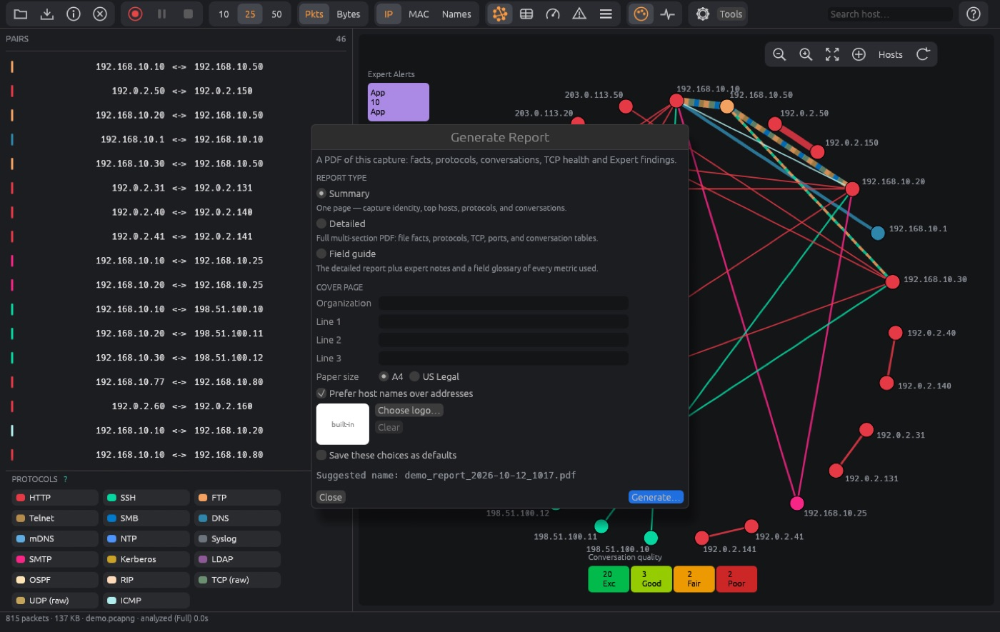

**Report** builds a multi-section PDF: file summary with SHA-256, charts, port and TCP analysis, and annotated sections. You can set a logo (PNG or JPEG up to 2 MB, drawn top left up to 40 mm); the PacketCircle mark is the fallback.

## 15. Settings

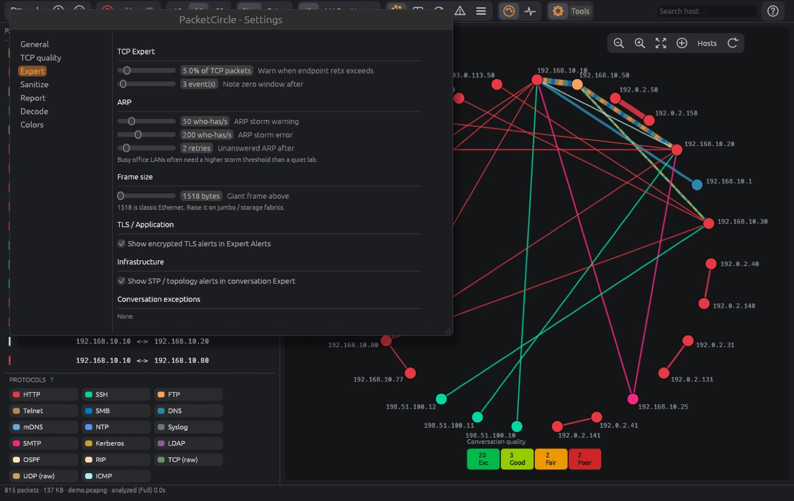

| Pane | Controls |
|---|---|
| General / Quality | Host names, quality strictness |
| **Expert** | Retransmit % and zero-window thresholds, TLS alerts on the strip, suppressed alert types |
| Sanitize / Report | Defaults for sanitizing and the PDF cover |
| Decode | Maximum frames, fonts |
| **Appearance** | **Dark**, **Light**, or follow the desktop |

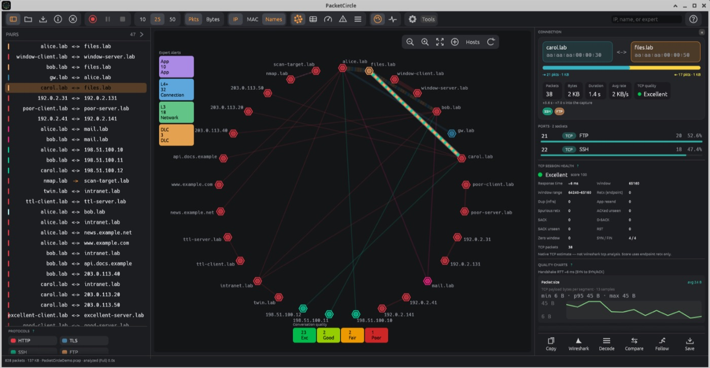
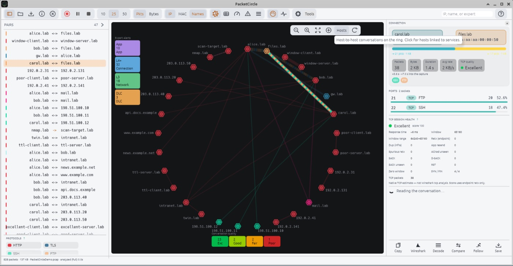

## 16. Workflows

**A. First look.** Open the capture → read the circle → click the thickest or reddest chord → read Connection details.

**B. Diagnose a bad TCP session.** Click a conversation with a poor grade → choose the socket → read TCP quality and charts → open Follow or Decode → copy the filter to Wireshark if you need more.

**C. Who is scanning or noisy?** Open Expert → check Network and Transport tiles → right-click for the alert list → select the offender.

**D. Compare before/after.** Open both captures → **Compare** → turn on *Differences only*.

**E. Triage live.** Enable capture → **Capture…** → pick interface and BPF → watch the circle grow → Stop → Save a copy.

**F. Share a capture.** Save → choose Payload + IP/MAC → send the sanitized file.

## 17. Environment variables

| Variable | Purpose |
|---|---|
| `PC_ANALYSIS_DEPTH=light\|full` | Answer the large-capture question without a dialog |
| `PC_SHOT=out.png` | Save a screenshot and exit (used for documentation) |
| `WGPU_BACKEND=gl` | Force software OpenGL on machines without Vulkan |

---

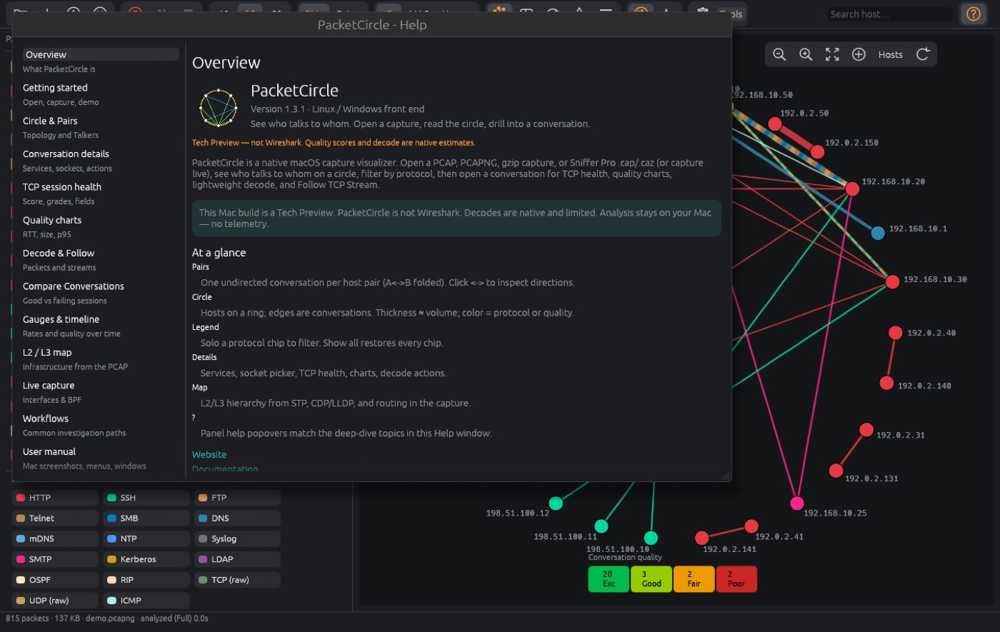

The built-in **Help** repeats the essentials of this manual offline.
