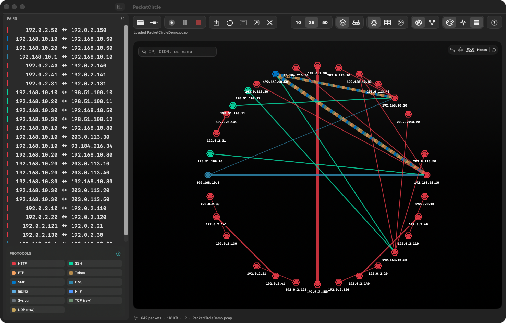

# PacketCircle for macOS — Installation

<p align="center"></p>

PacketCircle for macOS is a native SwiftUI app with the shared Rust analysis core.

**Quick links:** [Quickstart](./QUICKSTART.md) · [User manual](./USER-MANUAL.md) · [Detailed usage](./DETAILED-USAGE.md) · [Limitations](./LIMITATIONS.md) · [Master document](../PACKETCIRCLE-NATIVE.md)

## 1. Requirements

| | |
|---|---|
| **macOS** | 14 (Sonoma) or newer |
| **Hardware** | Apple Silicon (arm64). Earlier builds were universal arm64 + x86_64 |
| **Live capture** | Read/write access to `/dev/bpf*` (see section 4) |
| **Optional** | Wireshark, for *Wireshark* hand-off |

## 2. Install

1. Download `PacketCircle-<version>.dmg` (current: **1.3.2**).
2. Open the DMG and drag **PacketCircle** into **Applications**.
3. Start it from Launchpad or Spotlight.

The DMG is signed with a Developer ID certificate and notarized, so Gatekeeper opens it normally. An ad-hoc or development-signed build only runs on the Mac it was built for.

If macOS says the app cannot be opened because it is from an unidentified developer, right-click the app → **Open** → **Open**, or allow it in **System Settings → Privacy & Security**.

### Updating

Quit PacketCircle, then replace the app in Applications with the new one. A running app does not pick up a new build.

### Uninstalling

Quit the app and drag it to the Trash. Settings live in `~/Library/Preferences/com.netwho.PacketCircle.mac.plist`; delete it to reset.

## 3. First launch

- **File → Open Capture…**, **Open Recent**, or drop a capture on the window.
- No capture handy? Use the demo from the empty state or **Help**.
- Settings are under **PacketCircle → Settings…** (Cmd-,).

Continue with the [Quickstart](./QUICKSTART.md).

## 4. Allow live capture

Opening files needs no permission. To capture from an interface PacketCircle needs access to the BPF devices:

- **Easiest:** install Wireshark, whose installer includes *ChmodBPF* and grants your user access at login; or
- run the capture helper with an administrator prompt when PacketCircle asks.

Without access the capture window says so (*Capturing needs access to /dev/bpf\* (Wireshark's ChmodBPF installs it) or sudo*). *PCAP over IP* needs no special permission.

## 5. Build from source (developers)

Source is proprietary and not distributed with the documentation; this section is for authorized builders of the private repository.

```bash
./build.sh --run --rust                       # Rust-core build, release, arm64, then launch
./build.sh --test                             # Swift unit tests
scripts/package-macos.sh --rust --notarize --notary-profile PacketCircleNotary   # signed DMG
```

Needs Xcode 15+ command-line tools, a Rust toolchain, and for sharing builds a Developer ID Application certificate plus notarization credentials. See the repository's `docs/BUILDS.md`.

## 6. Troubleshooting

| Symptom | Fix |
|---|---|
| App will not open | See Gatekeeper note above; confirm macOS 14+ |
| *Capturing needs access to /dev/bpf\** | Install Wireshark (ChmodBPF) or allow the admin prompt |
| Old behavior after updating | Quit fully (Cmd-Q) and reopen |
| Window larger than the screen | Fixed in 1.3.2; update |
