# PacketCircle macOS User Manual

*Tech Preview (1.1.0). Screenshots below are from the current build against the built-in Demo Mode capture (`PacketCircleDemo.pcap`), in **dark mode**.*

---

## 1. Background and motivation

PacketCircle macOS is the desktop half of PacketCircle Native — a Swift/SwiftUI rewrite of the ideas behind the original open-source [PacketCircle Wireshark plugin](https://github.com/netwho/PacketCircle). It shares `PacketCircleCore` with the iOS app: open a PCAP/PCAPNG (or capture live), see who's talking to whom, spot rough TCP health, and drill into a conversation — all without shipping Wireshark or a GPL dissection stack.

### What PacketCircle macOS is

- A **capture visualizer** built around **conversation topology** (the circle), a sortable **pair table**, **rate/quality gauges**, and a **native packet Decode window**.
- A **desktop-native** app: Decode opens in its own window, **live capture** from local interfaces, **replay** of a capture at original timing, and one-click **handoff to Wireshark** when you need its full dissector depth.
- A **proprietary** product (see [License](../LICENSE.md)), implemented in Swift.

### What PacketCircle macOS is not

**PacketCircle is not a desktop Wireshark.**

It contains no open-source Wireshark / libwireshark dissection. Decode is native and best-effort: solid IP/TCP/UDP detail and some application-layer recognition, not dissector-for-dissector parity with Wireshark. TCP session-quality grades are a **native heuristic**, explicitly labeled "not Wireshark `tcp.analysis`" wherever shown. When you need full dissector depth, **Open in Wireshark** hands the capture off with the current display filter already copied.

For caveats and capacity notes, see [Limitations](LIMITATIONS.md).

---

## 2. Getting started

| Step | Action |
|------|--------|
| 1 | Open `PacketCircle.app` (Tech Preview DMG — see [Quickstart](QUICKSTART.md) for install). |
| 2 | **Open Capture…** (`⌘O`) to load a PCAP/PCAPNG, or **Demo Mode** if you just want to look around. |
| 3 | For live traffic, **Interfaces…** (`⇧⌘I`) instead. |
| 4 | Explore **Circle → Table → Gauges** from the view-options bar; open **Decode** (`⇧⌘D`) when you need packet-level detail. |

Before anything is loaded, the main window offers the same four entry points directly on the canvas:

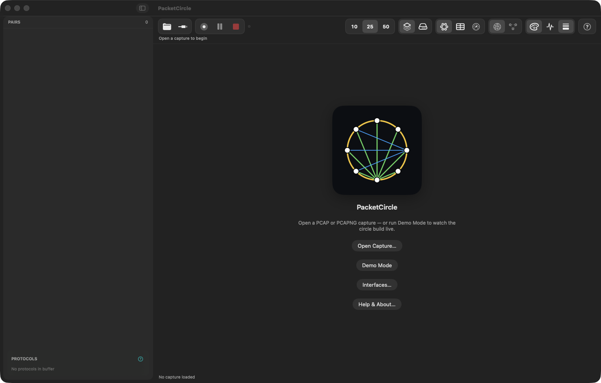

---

## 3. Main window layout

The window is a single split view: a **sidebar** (pair list + protocol legend) on the left, and the active **display mode** (Circle / Table / Gauges) on the right, with a two-row toolbar above.

Loading a capture adds a second row of toolbar icons for export, reset, report, external-open, and close, next to the transport controls. The protocol legend at the bottom of the sidebar lists every protocol seen in the capture in two columns (HTTP, FTP, SMB, mDNS, Syslog, UDP (raw) · SSH, Telnet, DNS, NTP, TCP (raw) in the demo capture); click one to filter, and where the list is long a **Show all** link expands it.

### 3.1 Primary toolbar

| Control | Shortcut | Role |
|---|---|---|
| Open | `⌘O` | Open a PCAP/PCAPNG file |
| Interfaces | `⇧⌘I` | Choose a local interface and start a live capture |
| Transport controls | — | Start / pause / resume / stop the current live capture or replay |
| Export | `⌘S` | Save Capture As… |
| **Reset** | — | Clears selection, protocol filter, and manual direction overrides. Icon fills accent-orange when there's something to clear, greyed out and disabled otherwise. |
| Report | — | Generate a session report |
| Open externally | — | Hand the capture off (e.g. to Wireshark) |
| Close | `⇧⌘W` | Close Capture — clear the session |
| Decode | `⇧⌘D` | Open the Decode window |

### 3.2 View options bar

| Control | Options | Role |
|---|---|---|
| Top N | 10 / 25 / 50 | How many conversations the Circle shows |
| Layout mode | layers / cloud icons | Display grouping |
| Display mode | Circle / Table / Gauges | Switch the main canvas |
| Address mode | globe / node-graph icons | IP vs MAC pairing |
| Edge color | palette icon | Color arcs by protocol category, or by native TCP session-quality grade |
| Line weight | waveform icon | Toggle traffic-volume line thickness |
| Help | `?` | In-app help |

### 3.3 Sidebar

The pair list ("Talkers list" in the app's own terminology — see Settings) mirrors what's on the circle, filtered by the protocol legend. Selecting a row highlights it orange and highlights the matching arc on the circle.

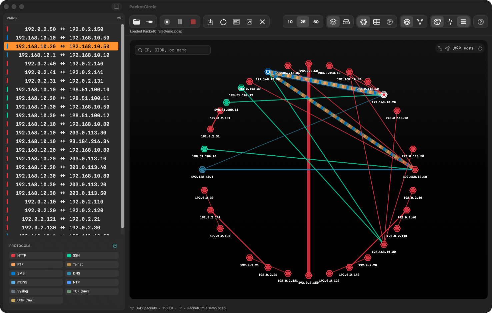

---

## 4. Circle view

Hosts sit on a ring as hexagonal nodes; each conversation is an arc, colored and weighted per the view options above. One-way traffic is dotted with an arrowhead; two-way traffic is a solid line (dual TCP+UDP pairs alternate dashes).

**Gestures**

| Gesture | Effect |
|---|---|
| Pinch / scroll | Zoom |
| Drag | Pan |
| Click an arc | Select the conversation — opens the [connection popup](#5-connection-details-popup) |
| Click a node | Select that host's busiest conversation |
| Right-click an arc | Context menu (below) |
| Right-click a node | Restart capture · host · Copy BPF · host · Select station |

**Floating canvas controls** (top-right): a search field (IP, CIDR, or name), fit-to-screen, rearrange (re-lay-out node angles for readability — angles then stay stable as a live graph grows), a **Hosts** toggle, and **Reset**.

### 4.1 Right-click on an arc (conversation)

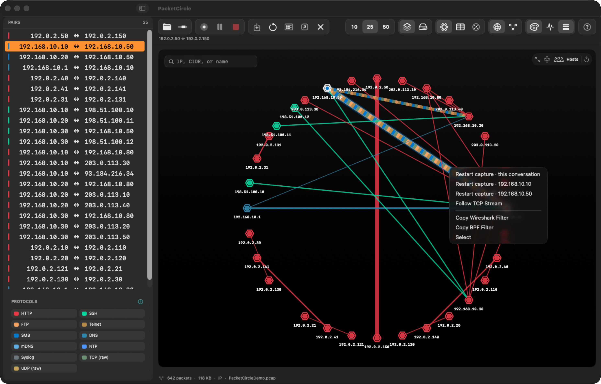

Restart capture · this conversation · Restart capture · *src* · Restart capture · *dst* · Follow TCP Stream · Copy Wireshark Filter · Copy BPF Filter · Select

---

## 5. Connection details popup

Selecting a conversation (click an arc, a sidebar row, or a node) opens a floating popup with a real triage panel for that pair — not just an address summary.

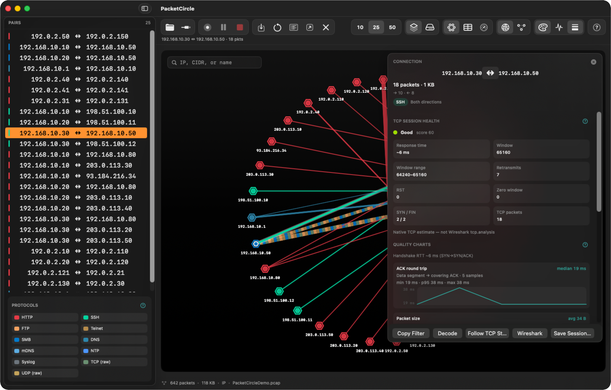

| Section | Contents |
|---|---|
| Header | Endpoints, packet/byte totals, directional split (→ / ←), protocol badge, direction (both/one-way) |
| **TCP session health** | Grade (Excellent/Good/Fair/Poor) and score, response time, window size, window range, retransmits, RST count, zero-window count, SYN/FIN count, TCP packet count. Footer note: *"Native TCP estimate — not Wireshark `tcp.analysis`."* |
| **Quality charts** | Handshake RTT (SYN → SYN/ACK), and an ACK-round-trip sparkline with median/min/p95/max labels over the sampled data segments |
| Packet size | Average packet size for the pair |

**Actions** (bottom of the popup): **Copy Filter** · **Decode** (opens the Decode window filtered to this pair) · **Follow TCP Stream** · **Wireshark** (opens in Wireshark with the filter copied) · **Save Session…** (save just this conversation out as its own capture file).

Closing the popup (×) also clears the selection, so the sidebar row and circle arc stop being highlighted.

---

## 6. Table view

A sortable table of the same Top-N pairs, with real analysis columns rather than just addresses: Source, Destination, Ports, Pkts, Bytes, Protocol, **Quality** (grade + score), **Issues** (retransmit/zero-window counts as `R:n Z:n`), Window (size range), and further RTT/health columns off to the right.

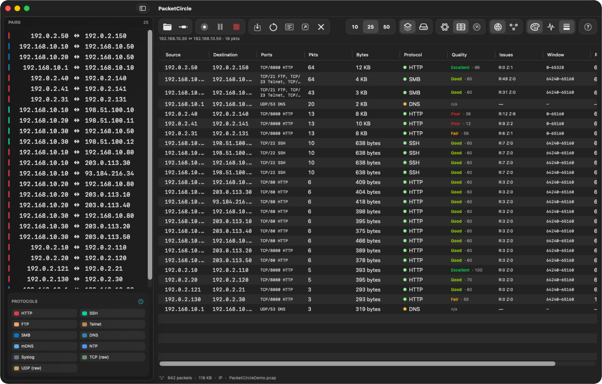

---

## 7. Gauges view

A dashboard of rate gauges and distribution charts:

- Arc gauges for **packets/s**, **bytes/s**, and **errors/s**. Over a static capture these read **"Session average"**; during a live capture or replay they switch to **"Instantaneous"** with a live trend sparkline underneath.
- **Top Talkers** bar charts, by bytes and by packets.
- **Top Protocols** by packet share.

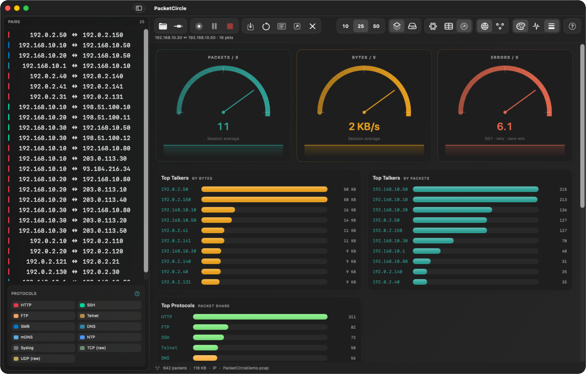

---

## 8. Decode window

Decode opens in its **own window** (`⇧⌘D`, or the toolbar Decode button) so you can keep the Circle in view while reading packets.

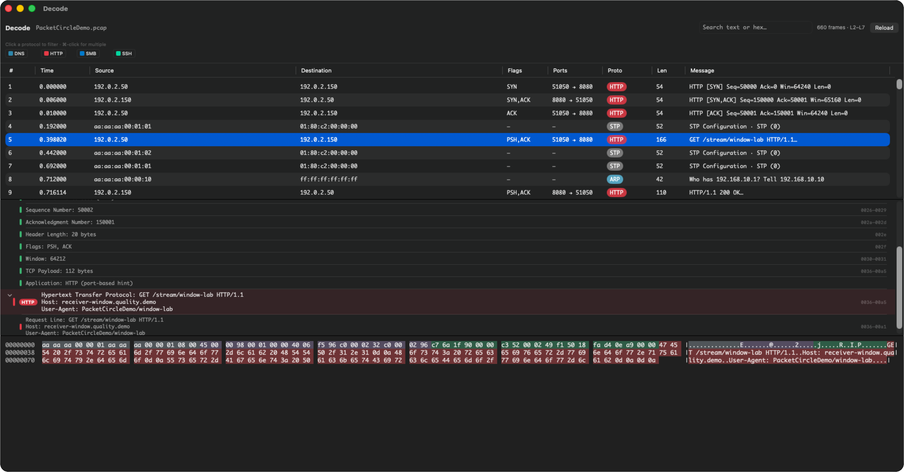

| Area | Contents |
|---|---|
| Header | Capture name, frame count and layer range (e.g. *"660 frames · L2-L7"*), text/hex search field, **Reload** |
| Filter chips | One chip per protocol seen (DNS, HTTP, SMB, SSH, …) — click to filter, `⌘`-click for multiple |
| Packet list | `#`, Time, Source, Destination, Flags, Ports, Proto, Len, Message |
| Protocol tree | Expandable frame detail (e.g. TCP sequence/ack numbers, header length, flags, window, payload length) down through the recognized application layer |
| Hex dump | Byte-for-byte view of the selected frame, synced to the tree selection |

Open it filtered to one conversation via **Decode** in the connection popup, or unfiltered via the toolbar/`⇧⌘D` for the whole capture. Font, size, and per-protocol colors for this window are configured in [Settings](#12-settings).

---

## 9. Follow TCP Stream

An in-window modal (not a separate window) that reassembles one TCP flow's payload bytes.

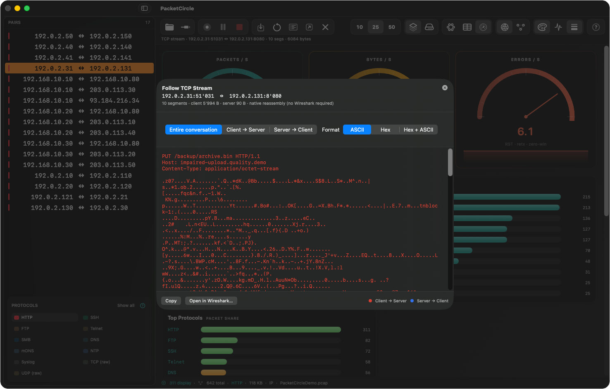

The header states segment count and byte totals per side (e.g. *"10 segments · client 5,994 B · server 90 B · native reassembly (no Wireshark required)"*).

| Control | Options |
|---|---|
| Direction | Entire conversation · Client → Server · Server → Client |
| Format | ASCII · Hex · Hex + ASCII |
| Actions | **Copy** · **Open in Wireshark…** |

Client/server bytes are color-coded (a legend in the corner marks which color is which direction) — useful even before reading a single byte, to see how lopsided a conversation was.

---

## 10. Live capture

**Interfaces…** (`⇧⌘I`) opens a sheet listing local interfaces (native, live rates via `dumpcap`) with a traffic sparkline and packets/s per interface.

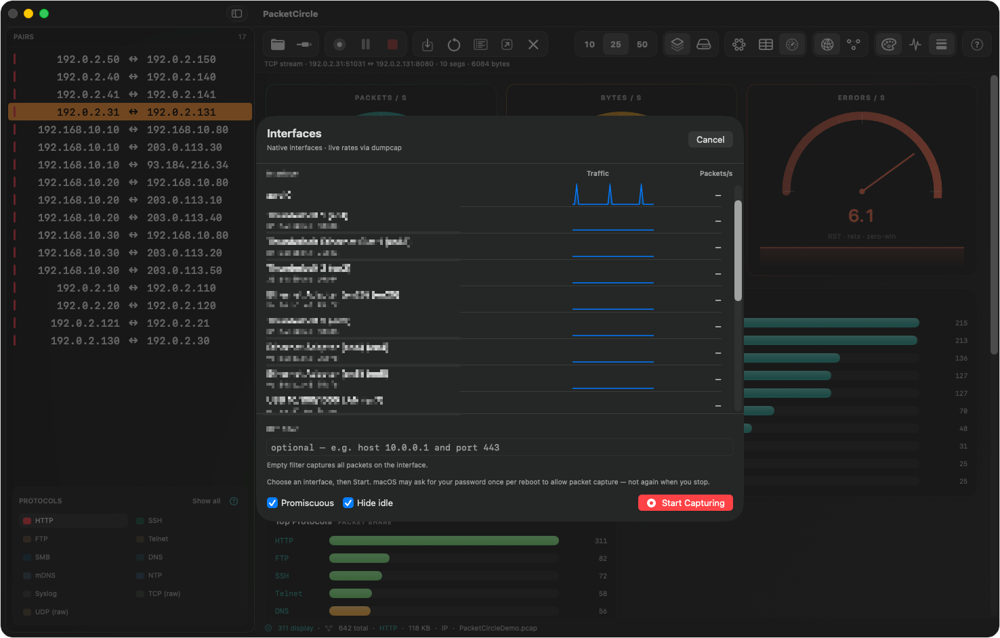

Below the interface list: an optional BPF filter field (*"optional — e.g. host 10.0.0.1 and port 443"*; empty captures everything), and **Promiscuous** / **Hide idle** toggles. **Start Capturing** begins the capture; **Cancel** backs out.

> macOS may ask for your password once per reboot to allow packet capture — not again when you stop.

Once running, the status line reads e.g. **"● CAPTURING · en0 · 292 pkts · 34 pairs"**, Gauges switch to **Instantaneous** readings with live sparklines, and the footer reminds you: *"All traffic — Save to keep · right-click pair/node to filter."*

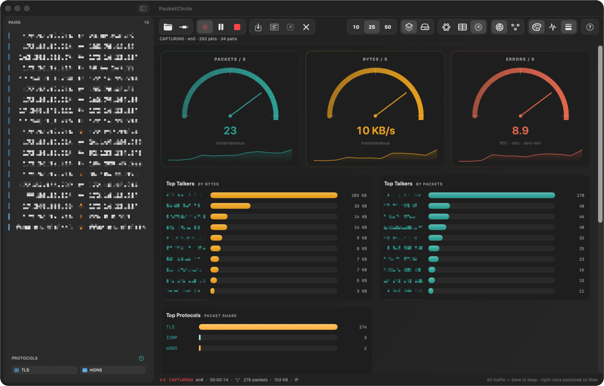

Right-click actions on the circle (**Restart capture · this conversation** / **· host**) restart the live capture with a BPF filter scoped to just that traffic — handy for narrowing in without losing the live view.

---

## 11. Replay and Demo Mode

- **Demo Mode** loads a bundled sample capture — the fastest way to see the app populated without your own PCAP. All screenshots in this manual use it.
- **Replay** (`⌥⌘R`) replays an already-open file at its original inter-frame timing, so arcs and gauges animate the way they would live. **Stop** (`⌘.`) ends it and returns to the static full-file view.

---

## 12. Settings

Settings has three tabs: **Display**, **Decode**, and **Colors**.

### 12.1 Display

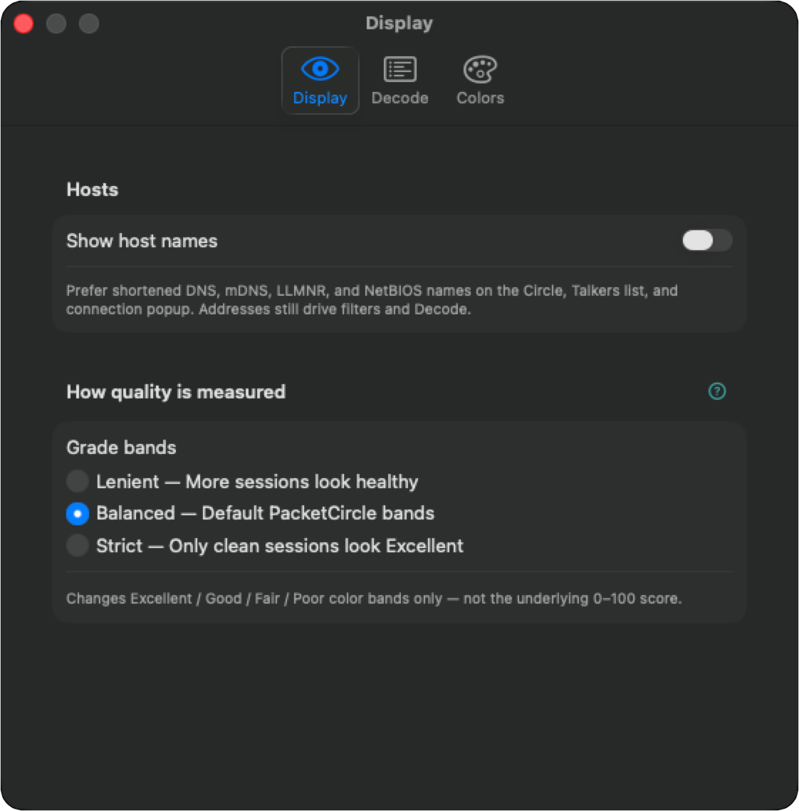

| Setting | Purpose |
|---|---|
| **Show host names** | Prefer shortened DNS / mDNS / LLMNR / NetBIOS names on the Circle, Talkers list, and connection popup. Addresses still drive filters and Decode regardless of this setting. |
| **How quality is measured — Grade bands** | **Lenient** (more sessions look healthy) · **Balanced** (default) · **Strict** (only clean sessions look Excellent). This changes only the Excellent/Good/Fair/Poor **color bands** — not the underlying 0–100 score. |

### 12.2 Decode

| Setting | Purpose |
|---|---|
| Font | Monospace font picker (only fixed-pitch fonts installed on the Mac are listed), with a live preview |
| Size | 9–20 pt slider |

Colors apply to the Decode packet list, protocol tree, and hex dump.

### 12.3 Colors

Per-protocol color overrides for the Decode window, with a **Reset All** to restore defaults.

---

## 13. Wireshark integration

**Open in Wireshark…** — from the toolbar, the connection popup, or Follow TCP Stream — hands the current capture (or filtered view) off to a locally installed Wireshark, with the equivalent display filter already copied to the clipboard so you can paste it straight into Wireshark's filter bar. Disabled if Wireshark isn't installed.

---

## 14. Keyboard shortcuts (reference)

| Shortcut | Action |
|---|---|
| `⌘O` | Open Capture… |
| `⌘S` | Save Capture As… |
| `⌥⌘S` | Save Capture to Downloads |
| `⇧⌘I` | Interfaces… |
| `⌥⌘D` | Demo Mode |
| `⌥⌘R` | Replay · Original Speed |
| `⇧⌘D` | Decode |
| `⇧⌘P` | Pause / Resume (live capture only) |
| `⌘.` | Stop (live capture or replay) |
| `⇧⌘W` | Close Capture |
| `⌘,` | Settings |
| `⌘Q` | Quit |

---

## 15. Workflows

### A. First look at a capture

1. `⌘O` to open a file (or Demo Mode).
2. On Circle, skim arcs; switch edge color to Quality to spot Fair/Poor sessions.
3. Click an arc for the connection popup, or open **Table** for a sortable list with quality/issue columns.

### B. Diagnose a bad TCP session

1. Edge color → Quality; look for orange/red arcs, or sort Table by the Quality column.
2. Click the arc → connection popup → read TCP session health (retransmits, RST, zero-window, RTT) and the quality charts.
3. **Follow TCP Stream** for payload, or **Decode** for frame-by-frame detail — both reachable directly from the popup.
4. **Save Session…** if you want to keep just this conversation as its own file.
5. **Reset** clears the selection and filter once you're done, ready for the next pair.

### C. Live triage on the wire

1. `⇧⌘I` → pick an interface, optionally set a BPF filter → Start Capturing.
2. Watch Circle/Gauges update live (Instantaneous readings, live sparklines); right-click a conversation → **Restart capture · this conversation** to narrow the live capture to just that traffic.
3. `⇧⌘P` to pause and inspect, `⌘.` to stop and analyze the full trace.

### D. Handoff to Wireshark

1. Select a conversation (or none, for the whole capture).
2. **Open in Wireshark…** from the toolbar, the popup, or Follow TCP Stream — the display filter is copied automatically.

---

## 16. Related documentation

| Doc | Topic |
|---|---|
| [Quickstart](QUICKSTART.md) | Install and first steps |
| [Detailed usage](DETAILED-USAGE.md) | Analyst workflows and alternate screenshot set |
| [Limitations](LIMITATIONS.md) | Capacity, decode depth, what's out of scope |
| [iOS User Manual](../ios/USER-MANUAL.md) | The phone/tablet counterpart |
| [License](../LICENSE.md) | Proprietary terms |
| [Privacy](../PRIVACY.md) | No data collection |
