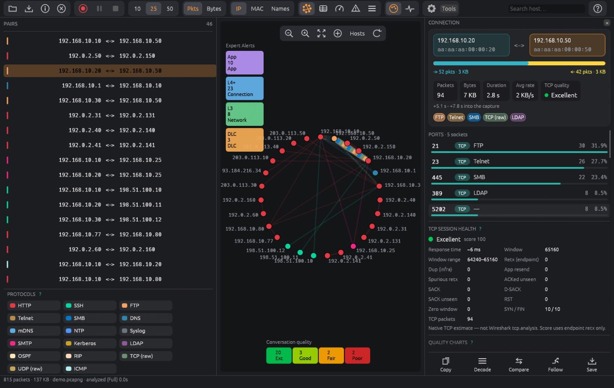

# PacketCircle for Windows — Installation

<p align="center"></p>

PacketCircle runs on Windows 10 and 11 (x64) as a native desktop app (egui, Rust-only — no Wireshark required).

**Quick links:** [Quickstart](./QUICKSTART.md) · [User manual](./USER-MANUAL.md) · [Limitations](./LIMITATIONS.md) · [Master document](../PACKETCIRCLE-NATIVE.md)

## 1. Requirements

| | |
|---|---|
| **OS** | Windows 10 or 11, x64 |
| **Graphics** | Any GPU/driver supporting DirectX 12, Vulkan or OpenGL |
| **Live capture** | [Npcap](https://npcap.com) installed as administrator (optional — files open without it) |
| **Optional** | Wireshark, for *Send to Wireshark* |

## 2. Choose an install method

| File | Use it when |
|---|---|
| `packetcircle-<version>-b<build>-windows-x64.msi` | You want a normal installer for all users (Program Files, Start menu, Settings → Apps). A newer MSI replaces an older one. |
| `packetcircle-<version>-b<build>-windows-x64.zip` | You want a portable zip, or a no-administrator per-user install via `install.ps1` |
| `packetcircle.exe` | You just want to run the program from any folder |
| `packetcircle-windows-src-<version>.zip` | You want to **build from source** ([section 5](#5-build-from-source)) |

## 3. Install

### 3.1 MSI (all users)

Double-click the `.msi`. It installs for every user (Program Files and the Start menu), shows the PacketCircle mark and a short note — free, no telemetry, no feature or size limits — and continues.

**SmartScreen.** An unsigned MSI downloaded from the internet shows *"Windows protected your PC… publisher could not be verified."* Choose **More info → Run anyway**. Windows then asks for administrator approval because the installer writes to Program Files.

If Npcap is not installed, the installer tells you and carries on; PacketCircle still opens and analyzes files.

### 3.2 Zip (current user, no administrator)

1. Unzip the archive.
2. Run:

```powershell
powershell -ExecutionPolicy Bypass -File install.ps1
```

This adds a Start menu entry and a Settings → Apps entry for the current user only.

### 3.3 Uninstall

- MSI: **Settings → Apps → PacketCircle → Uninstall**.
- Zip install:

```powershell
powershell -ExecutionPolicy Bypass -File uninstall.ps1 -Purge   # -Purge also removes settings
```

## 4. Install Npcap for live capture

Capturing from a network card needs **Npcap**, which is separate software with its own license.

1. Download the installer from <https://npcap.com> (the *Npcap installer*, not the SDK).
2. Run it **as administrator** and accept the defaults.
3. Restart PacketCircle and open **Capture…**.

*PCAP over IP* does not need Npcap.

## 5. Build from source

### Install once

1. **Build Tools for Visual Studio 2022** (or Visual Studio) with the workload **Desktop development with C++** (MSVC v143 + Windows 11 SDK).
2. **Rust** from <https://rustup.rs> (accept the MSVC defaults), or let `build.ps1 -InstallRust` do it.
3. **Npcap SDK** from <https://npcap.com/#download>, unzipped to `C:\npcap-sdk` (so `C:\npcap-sdk\Lib\x64\wpcap.lib` exists). Needed only to *build*.
4. **Npcap** runtime (optional, for live capture), see section 4.
5. **WiX CLI** for the MSI: `winget install WiXToolset.WiXCLI` or `dotnet tool install --global wix`. The exe and zip are still built without it. The build accepts the WiX v7 license for you (see <https://wixtoolset.org/osmf/>; a fee applies when annual revenue is over $10,000).

### Build

```powershell
cd packetcircle-windows-src-1.3.2
powershell -ExecutionPolicy Bypass -File scripts\windows\check-deps.ps1   # tells you what is missing
powershell -ExecutionPolicy Bypass -File scripts\windows\build.ps1        # exe, zip, and MSI
dist\packetcircle.exe testdata\some.pcap
```

Options: `-Test` (run tests), `-Jobs 2` (less RAM), `-InstallRust`, `-Sign …` (Authenticode). A log is kept in `build.log`.

### Sign (optional)

```powershell
build.ps1 -Sign -PfxPath C:\keys\code.pfx          # asks for the password on the console
build.ps1 -Sign -CertThumbprint <sha1>             # certificate in the Windows store / hardware token
```

SHA-256 signature plus RFC 3161 timestamp via `signtool`, on both the exe and the MSI. A signed build removes the SmartScreen warning.

## 6. First launch

Start **PacketCircle** from the Start menu, or:

```powershell
packetcircle.exe                 # empty start page
packetcircle.exe capture.pcapng  # open a capture directly
```

You can also drag a capture onto the window. Continue with the [Quickstart](./QUICKSTART.md).

## 7. Troubleshooting

| Symptom | Fix |
|---|---|
| SmartScreen blocks the installer | **More info → Run anyway**, or use a signed build |
| *Capture…* shows no interfaces | Install Npcap as administrator (section 4) and restart PacketCircle |
| Blank or black window / graphics error | Update the GPU driver; try `set WGPU_BACKEND=gl` before launching |
| Build fails at link time | Check `C:\npcap-sdk\Lib\x64\wpcap.lib` exists; run `check-deps.ps1` |
| Out of memory while building | `build.ps1 -Jobs 2` |

Build problems are logged to `build.log`; send that file with any report.
