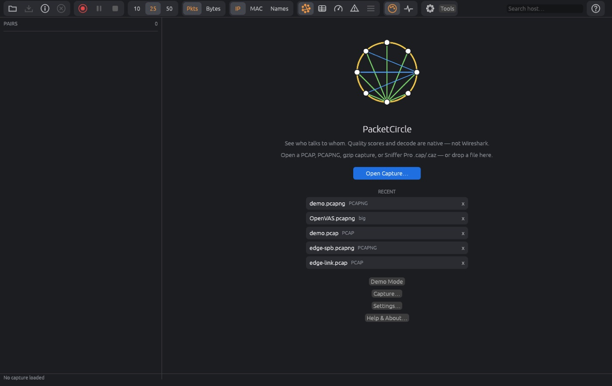
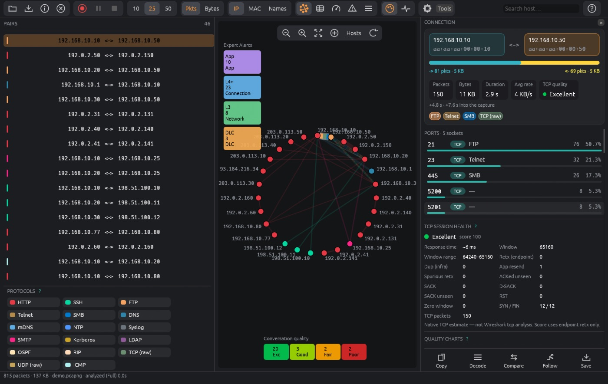
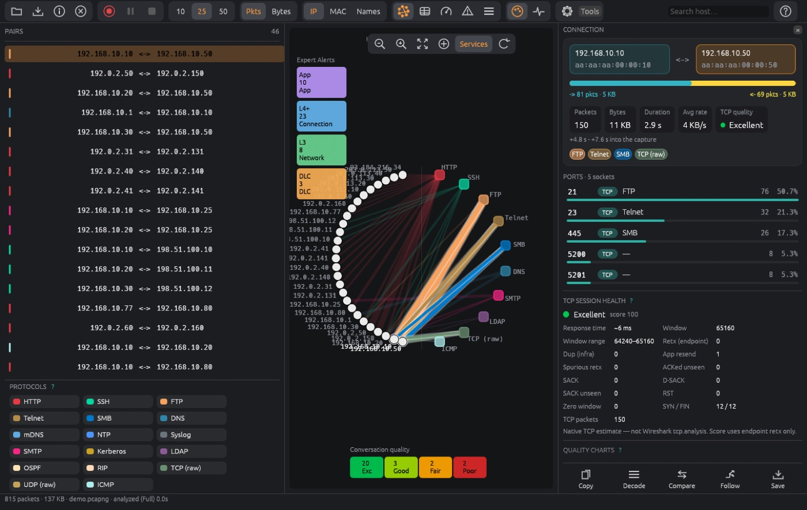
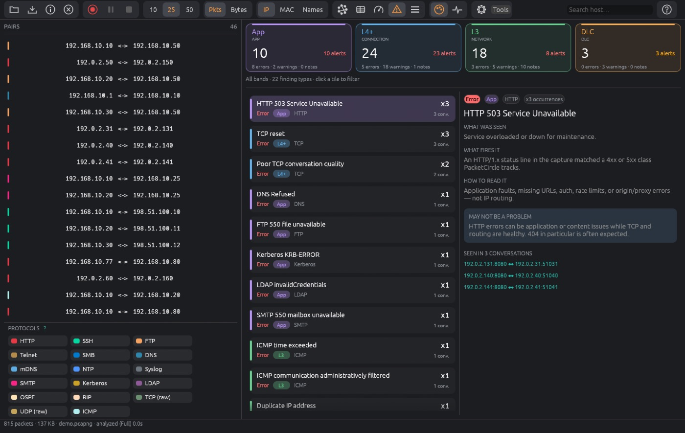
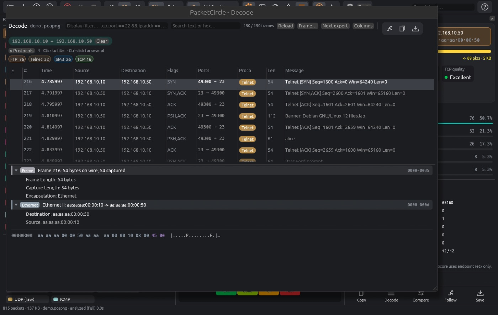

# PacketCircle for Windows — Quickstart

Five minutes from installed to useful. Not installed yet? See [Installation](./INSTALL.md).

## 1. Open a capture

- Run `packetcircle.exe capture.pcapng`, or
- Start the app and use **Open…** (or drag a `.pcap`, `.pcapng`, `.pcap.gz` or Sniffer `.cap`/`.caz` onto the window).
- No capture at hand? Use the demo from the start page or **Help**.

## 2. Read the circle

Hosts sit on a ring; each chord is a conversation. Colors are protocols. Thicker chords carry more traffic.

- **Hover** a chord or a row in the pairs list to highlight it.
- **Click** a chord to open its **Connection details**.
- Switch the layout between **Hosts**, **Services** and **Map**.

## 3. Find the problem

| Look at | Tells you |
|---|---|
| Quality grade on a conversation | TCP health, 0–100 |
| **Expert** tiles | Application / Transport / Network / Link findings |
| **Gauges** | Hosts, protocols and TCP health at a glance — click one to filter the circle |
| **Time slice** | Narrow the analysis to a time range |

## 4. Go deeper

On a conversation: **Decode** (packet list, tree, hex), **Follow TCP stream**, **Compare…**, **Copy filter**, **Send to Wireshark**.

## 5. Share safely

**Save** asks whether to **sanitize**. Choose cleartext, all payload, or payload plus IP/MAC scrubbing before the capture leaves your machine. **Report** builds a PDF.

## 6. Capture live (optional)

Install [Npcap](./INSTALL.md#4-install-npcap-for-live-capture) once (as administrator), then use **Capture…** in the toolbar, pick an interface, optionally enter a BPF filter, and press Start.

---

Next: the full [User Manual](./USER-MANUAL.md).
